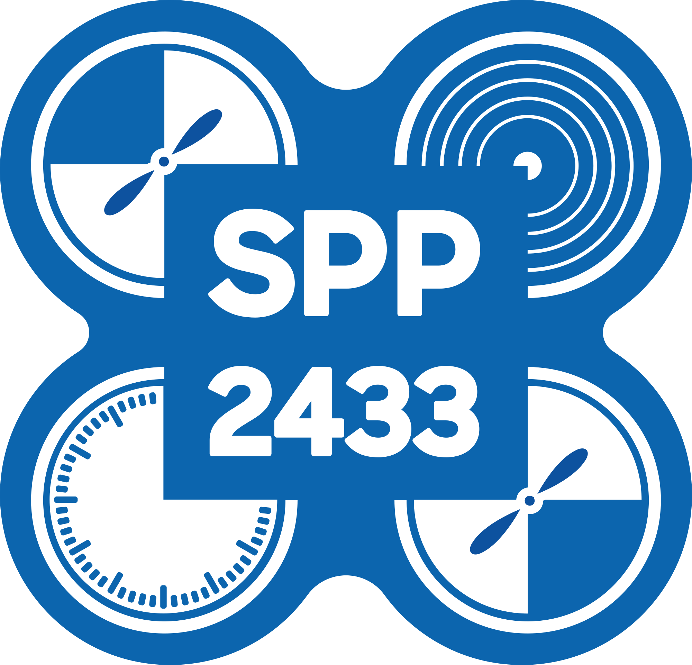
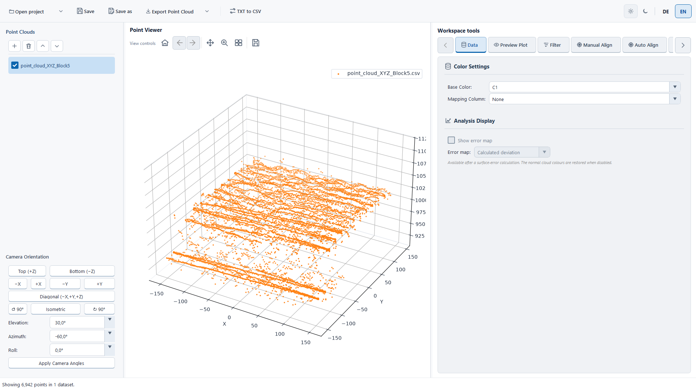

  

<h1 align="center">SPP 2433 — Point Cloud Evaluation</h1>

Load, align, compare, and export 3-D point clouds.

  

<em>The application with a loaded example point cloud.</em>

## Quick start

1. Download the latest `PointCloudEvaluation-*.exe` from [GitHub Releases](https://github.com/Heenne/spp2433_journal_evaluation/releases/latest).
2. Start the EXE. Python and Pixi are not needed.
3. Choose **Open project** to continue a saved analysis, or **Add point cloud** to load a comma-separated CSV or binary PLY. CSV files need `X`, `Y`, and `Z` columns.
4. Add the reference and measurement clouds, align them, then calculate surface error. Save the project to keep settings and results.

New to the app? Follow the [step-by-step user guide](docs/user-guide.md). It covers loading data, alignment, comparison, saving, and exports.

## Documentation

- [User guide](docs/user-guide.md) — complete workflow from first launch to saved results.
- [Algorithms and result metrics](docs/algorithms.md) — what the filters, aligners, error methods, and reported statistics do, including their parameters and references.
- [Developer guide](docs/development.md) — Pixi setup, running from source, and building the Windows EXE.
- [Windows release process](docs/windows-release.md) — maintainer build and release checklist.

## At a glance

- Load CSV and PLY point clouds and keep their order, visibility, transforms, analysis settings, reports, preview settings, and export profiles in a project file.
- Align manually, use bounded fine alignment, or try the broader PCA/FPFH global alignment.
- Compare a selected measurement with a reference using unsigned distance or signed local-plane deviation.
- Export transformed point-cloud data and publication-ready plot images.

Project files store settings and refer to the original point-cloud files by path; they do not contain the point data. Keep those files available when reopening a project.